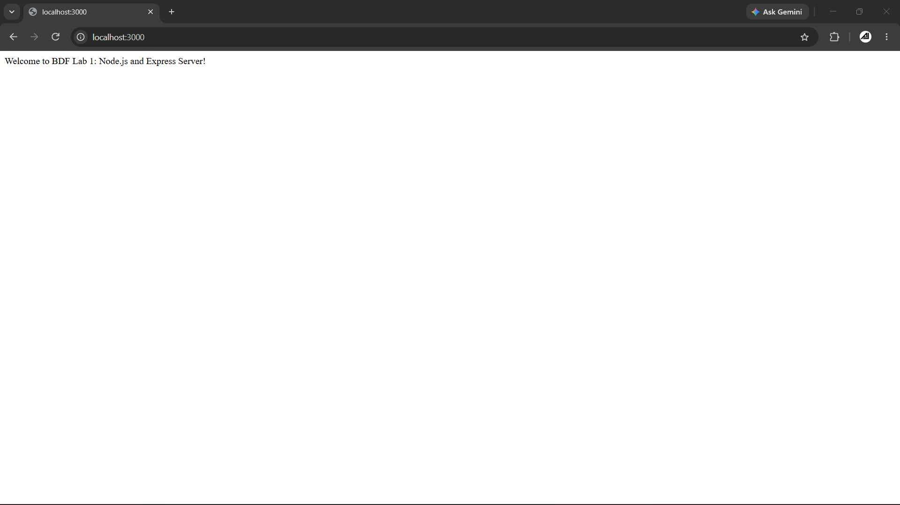
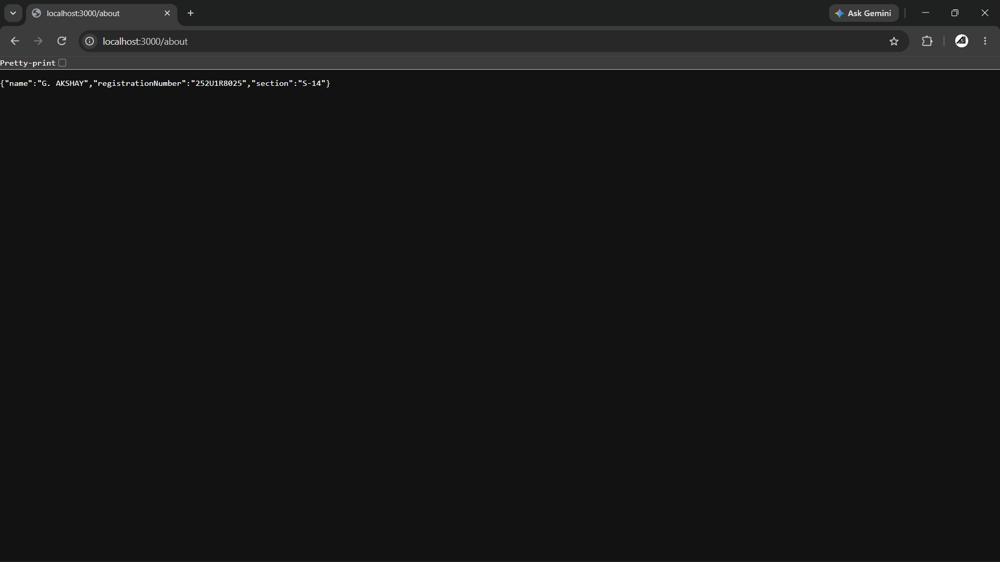
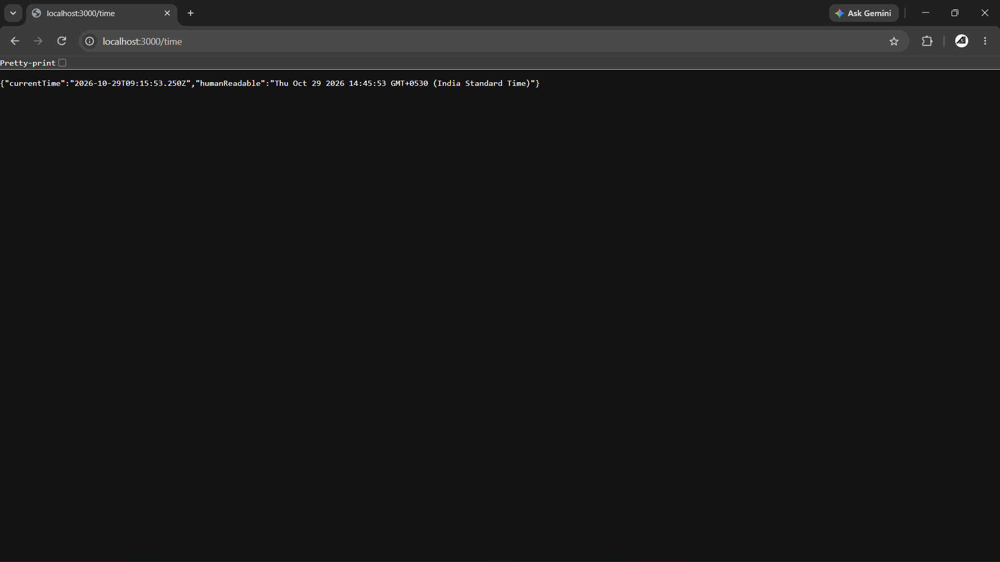
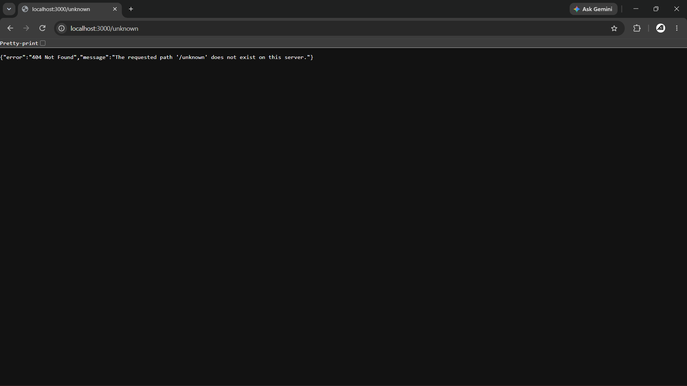

# Lab 1 — Node.js and Express Server

**Course:** Backend Development Frameworks (BDF)  
**Deployment Status:** Pending Deployment (Local development & verification complete)  
**Live Deployment URL: https://backend-labs-6mka.onrender.com

---

## Student Information

- **Student Name:** G. AKSHAY
- **Registration Number:** 252U1R8025
- **Section:** S-14

---

## Project Overview

This project implements the foundational requirements for **BDF Lab 1**, demonstrating how to build web servers using both native Node.js core modules and the Express framework:

1. **Native HTTP Server (`native-server.js`):** A lightweight server built using Node's core `http` module (`http.createServer()`) listening on port 3000 and returning the text `Hello`.
2. **Express Server (`server.js`):** A robust web application using Express (`app = express()`) implementing structured routing (`/`, `/about`, `/time`), dynamic time handling using `new Date()`, and a catch-all 404 handler for unknown paths.

---

## Prerequisites

- **Node.js:** v18.0.0 or higher (Verified on `v24.18.0`)
- **npm:** v9.0.0 or higher (Verified on `12.0.2`)
- **Web Browser or HTTP Client:** Chrome, Firefox, Postman, or `curl` for testing endpoints

---

## Installation & Setup

1. Open your terminal and navigate to the `lab-01` directory:
   ```bash
   cd lab-01
   ```

2. Install dependencies:
   ```bash
   npm install
   ```

> **Note:** The `node_modules/` folder is excluded from version control via `.gitignore`.

---

## Running the Servers

### 1. Running the Express Server (Implementation B)
To start the Express server on port 3000 (or `PORT` from environment):
```bash
npm start
```
*Alternatively:*
```bash
node server.js
```
The server will be accessible at: `http://localhost:3000`

### 2. Running the Native Node.js Server (Implementation A)
To start the native HTTP server separately:
```bash
npm run start:native
```
*Alternatively:*
```bash
node native-server.js
```
The server will be accessible at: `http://localhost:3000`

> **Important:** Stop one server (`Ctrl + C`) before starting the other if both use the default port 3000 to prevent port conflicts (`EADDRINUSE`).

---

## Port & Environment Variables

- **Default Port:** `3000`
- **Configurable Port:** Both servers support overriding the default port using the `PORT` environment variable:
  - **Linux / macOS:**
    ```bash
    PORT=8080 npm start
    ```
  - **Windows (PowerShell):**
    ```powershell
    $env:PORT="8080"; npm start
    ```
- **Security:** Secret keys and environment configurations are excluded using `.gitignore` to prevent leaking credentials.

---

## Express Server Route Documentation

| HTTP Method | Endpoint | Purpose / Description | Expected Status Code | Response Format & Sample Output |
| :--- | :--- | :--- | :--- | :--- |
| `GET` | `/` | Root endpoint displaying a welcome message | `200 OK` | `text/plain` or `text/html`<br>`"Welcome to BDF Lab 1: Node.js and Express Server!"` |
| `GET` | `/about` | Returns student details with name and section | `200 OK` | `application/json`<br>`{"name": "G. AKSHAY", "registrationNumber": "252U1R8025", "section": "S-14"}` |
| `GET` | `/time` | Returns the current server date and time using `new Date()` | `200 OK` | `application/json`<br>`{"currentTime": "2026-10-28T05:59:40.590Z", "humanReadable": "Wed Oct 28 2026 11:29:40 GMT+0530..."}` |
| `GET` / `ALL` | `/*` (Unknown) | Catch-all 404 handler for any undefined route | `404 Not Found` | `application/json`<br>`{"error": "404 Not Found", "message": "The requested path '...' does not exist on this server."}` |

---

## Verification & Testing Results

All requirements were verified through automated tests (`npm test` / `node test.js`) and direct HTTP verification:

### Automated Test Suite Results (`npm test`):
```text
========================================
Running BDF Lab 1 Automated Verification
========================================

Testing Implementation A: Native Node.js HTTP Server...
  [PASS] Status code is 200 (received: 200)
  [PASS] Response text is 'Hello' (received: 'Hello')

Testing Implementation B: Express Server...

- Testing GET /
  [PASS] Status code is 200 (received: 200)
  [PASS] Response contains welcome message (received: 'Welcome to BDF Lab 1: Node.js and Express Server!')

- Testing GET /about
  [PASS] Status code is 200 (received: 200)
  [PASS] Content-Type is JSON (received: 'application/json; charset=utf-8')
  [PASS] JSON contains 'name' property (value: 'G. AKSHAY')
  [PASS] JSON contains 'section' property (value: 'S-14')

- Testing GET /time
  [PASS] Status code is 200 (received: 200)
  [PASS] Content-Type is JSON (received: 'application/json; charset=utf-8')
  [PASS] JSON contains 'currentTime' (value: '2026-10-28T05:59:17.111Z')
  [PASS] currentTime is a valid ISO date timestamp

- Testing GET /any-unknown-path (404 Catch-All)
  [PASS] Status code is 404 (received: 404)
  [PASS] Response contains readable error message

========================================
Summary: 14/14 tests passed.
========================================
```

### Direct Port 3000 HTTP Verification:
- **`GET http://localhost:3000/` (Native):** Status `200 OK`, Output: `Hello`.
- **`GET http://localhost:3000/` (Express):** Status `200 OK`, Output: `Welcome to BDF Lab 1: Node.js and Express Server!`.
- **`GET http://localhost:3000/about` (Express):** Status `200 OK`, Output: `{"name":"G. AKSHAY","registrationNumber":"252U1R8025","section":"S-14"}`.
- **`GET http://localhost:3000/time` (Express):** Status `200 OK`, Output: `{"currentTime":"2026-10-28T05:59:40.590Z","humanReadable":"..."}`.
- **`GET http://localhost:3000/any-unknown-path` (Express):** Status `404 Not Found`, Output: `{"error":"404 Not Found","message":"The requested path '/any-unknown-path' does not exist on this server."}`.

---

## Problems Encountered & Resolutions

1. **Port Collision Between Servers:**
   - *Problem:* Running both the native HTTP server and the Express server concurrently on the default port `3000` leads to `EADDRINUSE` exception.
   - *Resolution:* Configured both servers to use `process.env.PORT || 3000`. Automated tests run on isolated dynamic ports (`3001` and `3002`) and close server instances immediately after verification. For manual execution, users run either server independently.

2. **Route Order and Catch-All 404 Handling:**
   - *Problem:* If 404 middleware is placed before regular route definitions, it intercepts valid requests.
   - *Resolution:* Registered the 404 handler (`app.use(...)`) at the very end of the middleware chain after all specific routes (`/`, `/about`, `/time`), ensuring that only unmatched paths trigger the 404 response.

---

## Screenshots

Browser test results verified and captured:

### 1. Home Route (`GET /`)
*Endpoint: `http://localhost:3000/`*



### 2. About Route (`GET /about`)
*Endpoint: `http://localhost:3000/about`*



### 3. Time Route (`GET /time`)
*Endpoint: `http://localhost:3000/time`*



### 4. 404 Not Found Route (`GET /any-unknown-path`)
*Endpoint: `http://localhost:3000/any-unknown-path`*



---

## Deployment Status

- **Status:** **Pending Deployment**
- **Hosting Target:** To be determined (e.g., Render, Railway, Vercel, or Fly.io) upon authorization.
- Real deployment verification will be conducted once hosting credentials/details are configured.

