# Lab 3: REST API, query parameters, validation, debugging

**Course:** Backend Development Frameworks (BDF)  
**Deployment Status:** Live on Render  
**Live Deployment URL:** https://bdf-lab-03-f7c9.onrender.com

---

## Student Details

- **Name:** G. AKSHAY
- **Registration Number:** 252U1R8025
- **Section:** S-14

---

## Project Description

This project implements the requirements for **BDF Lab 3: REST API, Query Parameters, Validation & Debugging**. It builds on foundational Express and SQLite concepts to deliver a production-grade RESTful API featuring:

1. **Rich Query Parameters on `GET /books/`:** Partial search (`search_q`), strict allowlisted sorting (`order_by`, `order`), safe pagination (`limit`, `offset`), and range filtering (`min_price`, `max_price`). All parameters work independently or concurrently.
2. **Robust Input Validation:** Strict request body validation for `POST /books/` and `PUT /books/:bookId/` returning clear HTTP 400 JSON errors.
3. **Security Best Practices:** Parameterized SQL queries using `?` placeholders for all user data values, paired with strict allowlists for SQL identifiers (column names, sort direction).
4. **Structured Error Handling:** Consistent JSON error response schema (`{"message": "..."}`) preventing internal trace leaks.
5. **Systematic Debugging:** Comprehensive documentation and demonstration of four classic backend errors in [DEBUGGING.md](./DEBUGGING.md).

---

## Technologies & Dependencies

- **Runtime:** Node.js v18.0.0+ (Verified on `v24.18.0`)
- **Package Manager:** npm v9.0.0+ (Verified on `v12.0.2`)
- **Database Engine:** SQLite CLI & Driver (Verified on `sqlite3` v3.53.4)
- **Key Dependencies:**
  - `express`: `^5.3.0` — Web application framework
  - `sqlite`: `^5.1.1` — Async Promise-based SQLite wrapper
  - `sqlite3`: `^6.0.1` — Native SQLite3 database driver
  - `nodemon`: `^3.1.14` — Development server with automatic reload

---

## Installation and Execution

### 1. Installation
Navigate to the `lab-03` directory and install dependencies:
```bash
cd lab-03
npm install
```

### 2. Development Mode (Auto-reload with Nodemon)
```bash
npm run dev
```

### 3. Production Start Mode
```bash
npm start
```

### 4. Automated Verification Test Suite
Run the 63-assertion verification suite covering all routes, query parameters, and edge cases:
```bash
npm test
```

### 5. Environment Variables
- **Required:** None. All configuration has safe local defaults.
- **Optional:** `PORT` (defaults to `3000` if not specified).

---

## Database

- **File Location:** `database/books.db`
- **Schema Script:** `database/init.sql`

### Schema (`book` table)
```sql
CREATE TABLE IF NOT EXISTS book (
    id INTEGER PRIMARY KEY,
    title TEXT,
    author TEXT,
    price INTEGER,
    pages INTEGER
);
```

### Initial Seed Data
The database is initialized with 10 technical book records covering varied price points, authors, and page counts.

### Inspecting via SQLite CLI
```bash
sqlite3 database/books.db
```
Inside the interactive prompt:
```sql
.tables
.schema book
SELECT * FROM book;
.exit
```

---

## API Endpoints

| HTTP Method | Endpoint | Description | Success Status | Error Statuses |
| :--- | :--- | :--- | :--- | :--- |
| `GET` | `/books/` | Retrieve books with search, sort, pagination & price filters | `200 OK` | `400 Bad Request`<br>`500 Internal Server Error` |
| `GET` | `/books/:bookId/` | Retrieve a single book record by ID | `200 OK` | `400 Bad Request`<br>`404 Not Found`<br>`500 Internal Server Error` |
| `POST` | `/books/` | Create a new book record | `201 Created` | `400 Bad Request`<br>`500 Internal Server Error` |
| `PUT` | `/books/:bookId/` | Full update of existing book record | `200 OK` | `400 Bad Request`<br>`404 Not Found`<br>`500 Internal Server Error` |
| `DELETE` | `/books/:bookId/` | Remove a book record by ID | `200 OK` | `400 Bad Request`<br>`404 Not Found`<br>`500 Internal Server Error` |

---

## Query Parameters (`GET /books/`)

| Parameter | Purpose | Type | Default | Example |
| :--- | :--- | :--- | :--- | :--- |
| `search_q` | Partial title search (SQL `LIKE %...%`) | String | None | `/books/?search_q=python` |
| `order_by` | Sorting column (`id`, `title`, `author`, `price`, `pages`) | String (Allowlisted) | `id` | `/books/?order_by=price` |
| `order` | Sort direction (`ASC`, `DESC`) | String (Allowlisted) | `ASC` | `/books/?order=DESC` |
| `limit` | Number of records to return (1–100) | Integer | `10` | `/books/?limit=5` |
| `offset` | Number of records to skip | Integer | `0` | `/books/?offset=5` |
| `min_price` | Minimum price filter (`price >= ?`) | Non-negative Number | None | `/books/?min_price=400` |
| `max_price` | Maximum price filter (`price <= ?`) | Non-negative Number | None | `/books/?max_price=700` |

### Combined Filter Example
All parameters can be supplied concurrently in a single query:
```text
GET /books/?search_q=python&order_by=price&order=ASC&limit=5&offset=0&min_price=200&max_price=800
```

---

## Validation & Error Handling

All validation failures return HTTP **`400 Bad Request`** with a structured JSON message:

```json
{
  "message": "Title is required"
}
```

### Validation Rules Summary:
- **`title`**: Required, non-empty string.
- **`author`**: Required, non-empty string.
- **`price`**: Required, non-negative finite number.
- **`pages`**: Optional; if provided, must be a positive integer.
- **`bookId`**: Must be a positive integer.
- **`order_by`**: Must strictly match allowlist (`id`, `title`, `author`, `price`, `pages`).
- **`order`**: Must strictly match `ASC` or `DESC`.
- **`min_price` / `max_price`**: Non-negative numbers; `min_price` must not exceed `max_price`.

---

## Debugging Exercise

Refer to the companion debugging document [DEBUGGING.md](./DEBUGGING.md) for full diagnosis, terminal commands, root causes, and fixes for:
1. **`EADDRINUSE`:** Port collision detection and cleanup using `netstat -ano | findstr :3000` and `taskkill`.
2. **Wrong Import Path:** Resolving `MODULE_NOT_FOUND` via explicit relative paths.
3. **Wrong Table Name:** Diagnosing `SQLITE_ERROR: no such table` using the SQLite CLI.
4. **Missing `await`:** Understanding unresolved Promise serialization bugs in async route handlers.

---

## Postman Testing

A preconfigured Postman collection covering all 32 test scenarios is located at:  
[`postman/Lab-03-REST-API.postman_collection.json`](./postman/Lab-03-REST-API.postman_collection.json)

### Importing and Running:
1. Open Postman $\rightarrow$ Click **Import**.
2. Select `lab-03/postman/Lab-03-REST-API.postman_collection.json`.
3. Ensure the `baseUrl` collection variable is set to `http://localhost:3000`.
4. Run requests individually or run the collection runner.

---

## Screenshots

### 1. GET All Books (`GET /books/`)
*Endpoint: `http://localhost:3000/books/` — Returns all seeded book records (`200 OK`)*
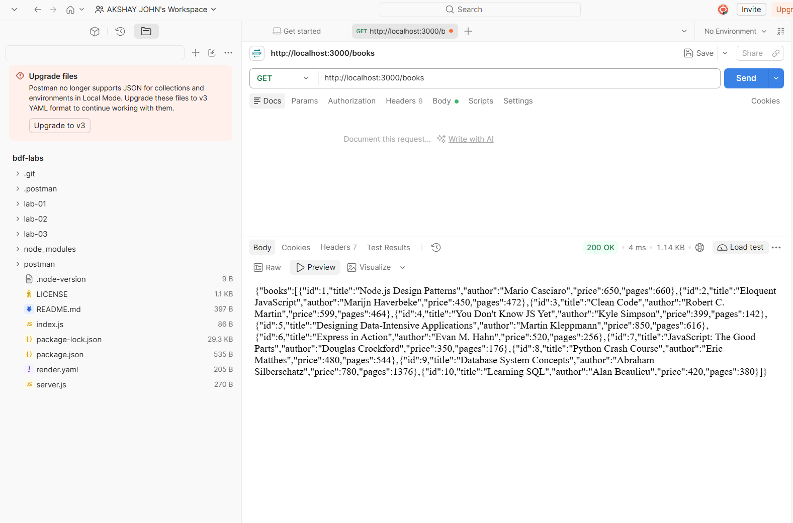

### 2. Search Books by Title (`GET /books/?search_q=python`)
*Endpoint: `http://localhost:3000/books/?search_q=python` — Partial title search using SQL `LIKE` (`200 OK`)*
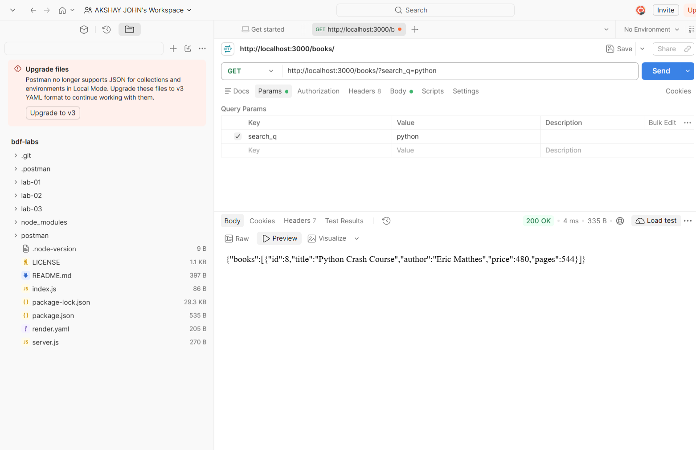

### 3. Sort Books by Price Descending (`GET /books/?order_by=price&order=DESC`)
*Endpoint: `http://localhost:3000/books/?order_by=price&order=DESC` — Allowlisted ORDER BY (`200 OK`)*
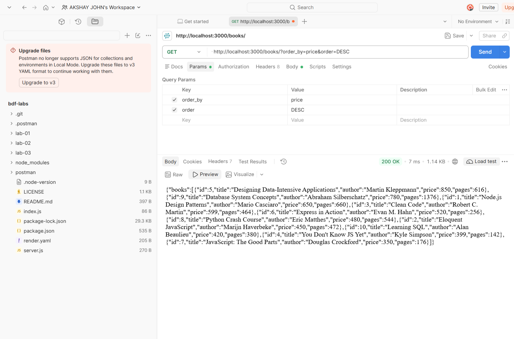

### 4. Pagination (`GET /books/?limit=5&offset=0`)
*Endpoint: `http://localhost:3000/books/?limit=5&offset=0` — SQL `LIMIT ? OFFSET ?` pagination (`200 OK`)*
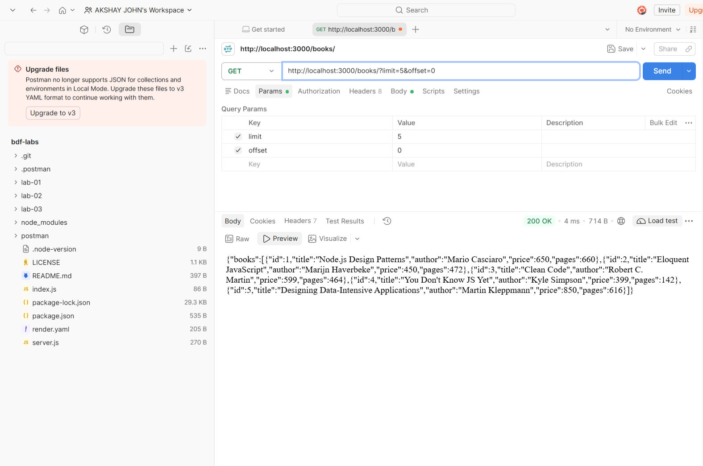

### 5. Price Range Filter (`GET /books/?min_price=400&max_price=600`)
*Endpoint: `http://localhost:3000/books/?min_price=400&max_price=600` — Bound query filtering (`200 OK`)*
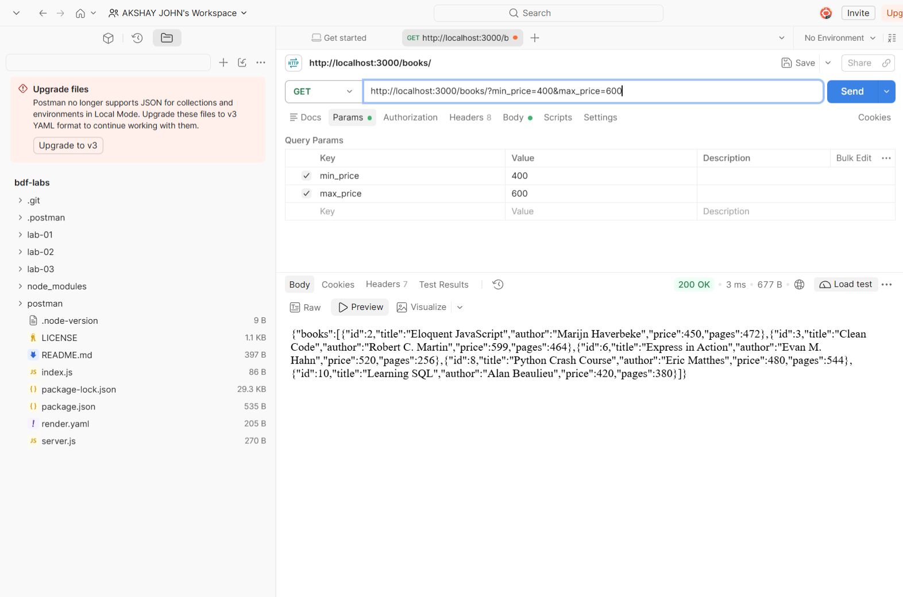

### 6. Combined Filters
*Endpoint: `GET /books/?search_q=python&order_by=price&order=ASC&limit=5&offset=0&min_price=200&max_price=800` (`200 OK`)*
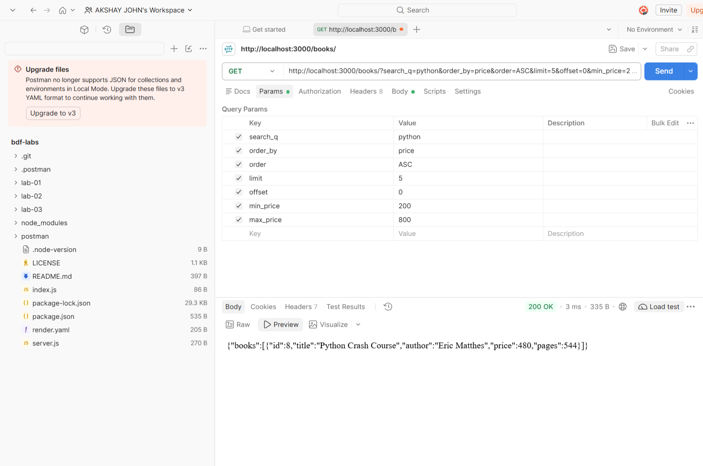

### 7. GET Single Book (`GET /books/1/`)
*Endpoint: `http://localhost:3000/books/1/` — Single resource retrieval via path parameter (`200 OK`)*
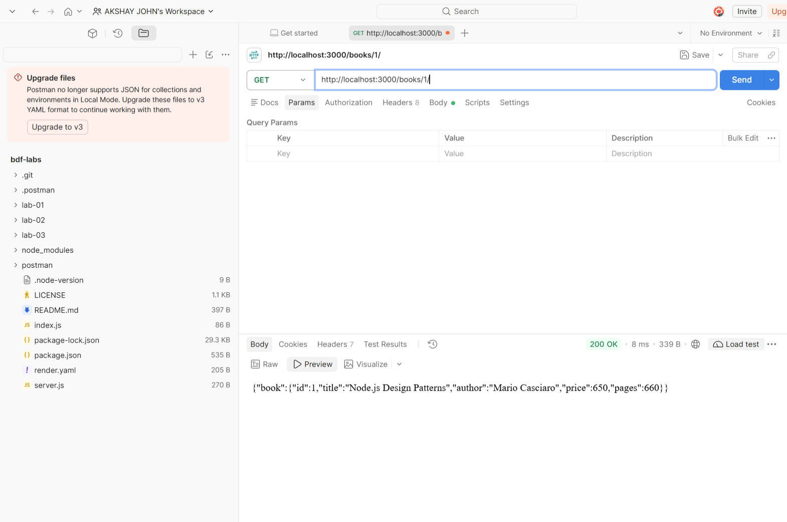

### 8. 404 Not Found Check (`GET /books/99999/`)
*Endpoint: `http://localhost:3000/books/99999/` — Structured error for missing resource (`404 Not Found`)*
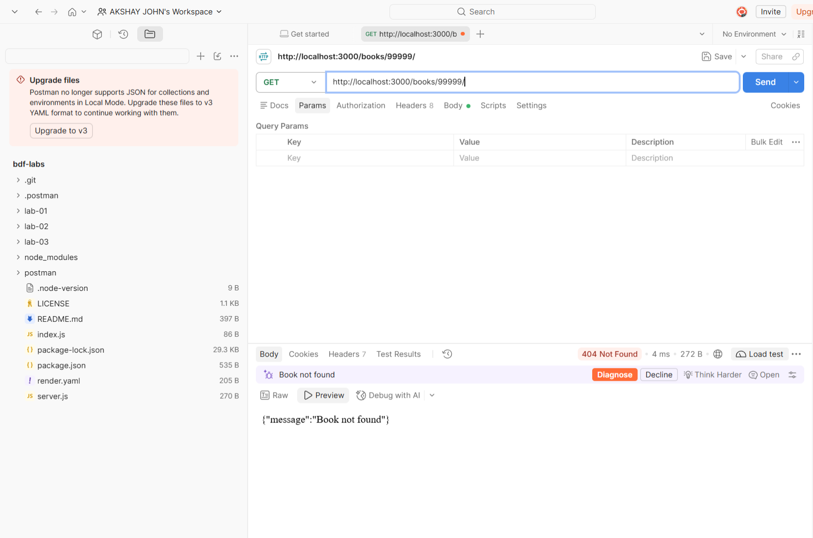

### 9. POST Create Book (`POST /books/`)
*Endpoint: `POST http://localhost:3000/books/` — Successfully created book record with dynamic ID (`201 Created`)*
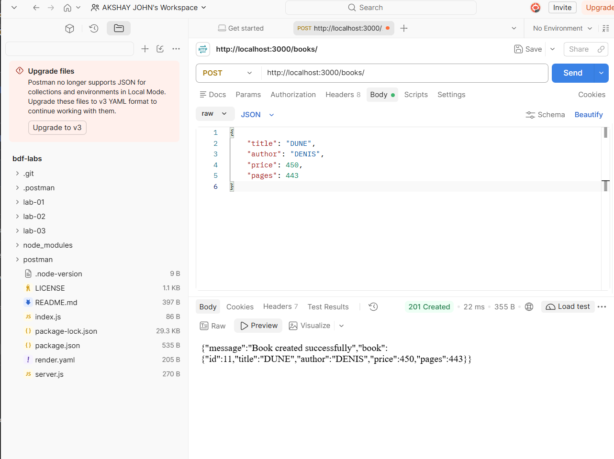

### 10. POST Validation Error (`POST /books/`)
*Endpoint: `POST http://localhost:3000/books/` — Validation rejection on negative price (`400 Bad Request`)*
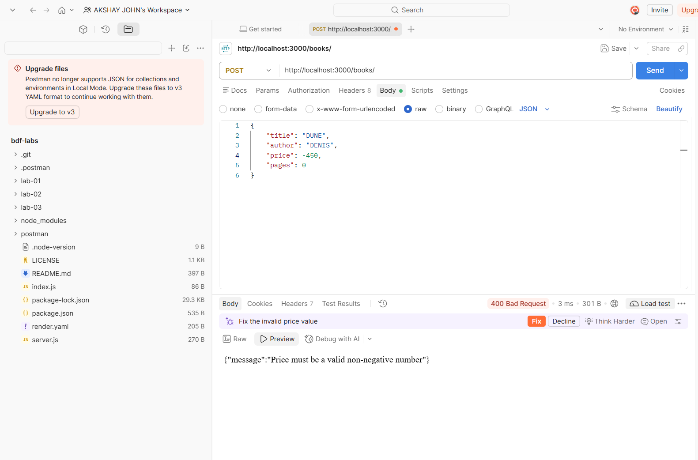

### 11. PUT Update Book (`PUT /books/11/`)
*Endpoint: `PUT http://localhost:3000/books/11/` — Full update of editable book fields (`200 OK`)*
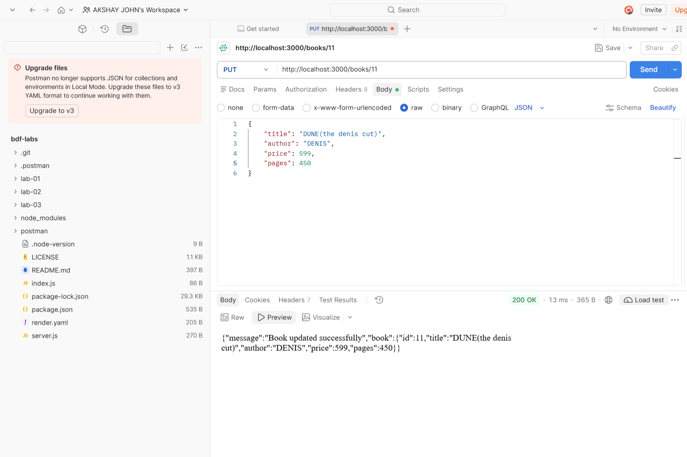

### 12. DELETE Book (`DELETE /books/11/`)
*Endpoint: `DELETE http://localhost:3000/books/11/` — Successful resource deletion (`200 OK`)*
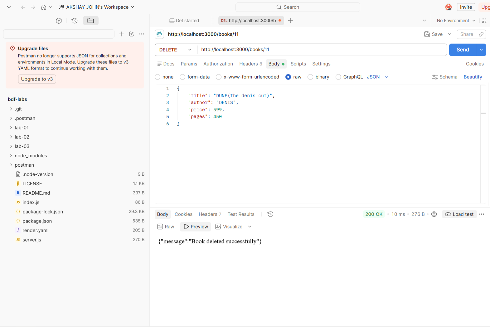

### 13. Debugging Diagnostics Verification
*Terminal output showing `netstat` port check, SQLite schema verification, and clean server startup*
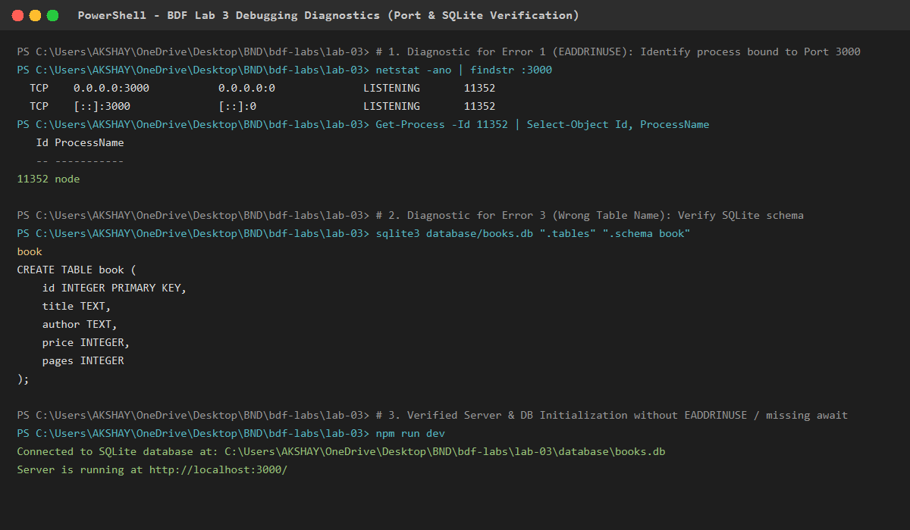

---

## Notes

### Problems Encountered & Resolutions

1. **SQL Injection Vulnerability in Dynamic ORDER BY:**
   - *Problem:* SQL placeholders (`?`) cannot be used for SQL identifiers such as column names or keywords (`ASC`/`DESC`).
   - *Resolution:* Implemented a strict allowlist verification (`['id', 'title', 'author', 'price', 'pages']` and `['ASC', 'DESC']`). Any value outside this allowlist immediately triggers a `400 Bad Request` rejection, ensuring untrusted strings are never interpolated into SQL statements.

2. **Logical Validation for Price Ranges:**
   - *Problem:* Users could supply a `min_price` higher than `max_price` (e.g. `min_price=900&max_price=200`), resulting in logically invalid SQL queries or unexpected empty results.
   - *Solution:* Added explicit pre-query validation checking `if (min_price > max_price)` and returning `400 Bad Request` with `{"message": "min_price cannot be greater than max_price"}`.

3. **npm 12 Lifecycle Script Policy for Native Compilation:**
   - *Problem:* npm 12 blocks native installation scripts by default, preventing `sqlite3` from compiling its native bindings.
   - *Solution:* Executed `npm install-scripts approve sqlite3` and persisted approval in `package.json` under `allowScripts`, followed by `npm rebuild sqlite3`.

4. **Seed Data Preservation During Destructive Verification:**
   - *Problem:* Running integration tests that perform `PUT` and `DELETE` could modify or delete the baseline seed records (IDs 1–10).
   - *Solution:* Configured test suites to create a dynamic disposable record with `POST`, capture its generated ID, perform `PUT` and `DELETE` on that record only, and assert that all 10 original seed records remain intact.

